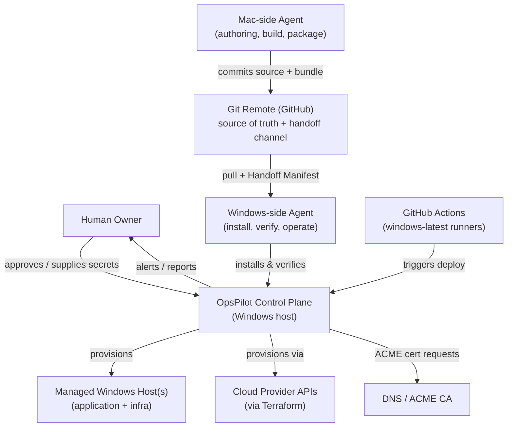
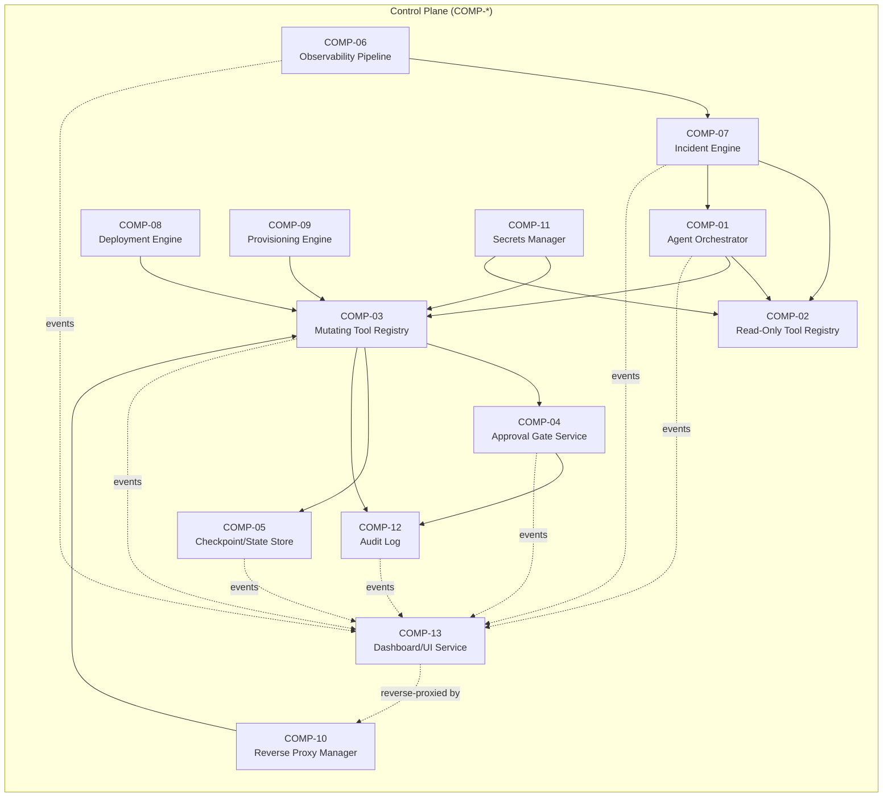
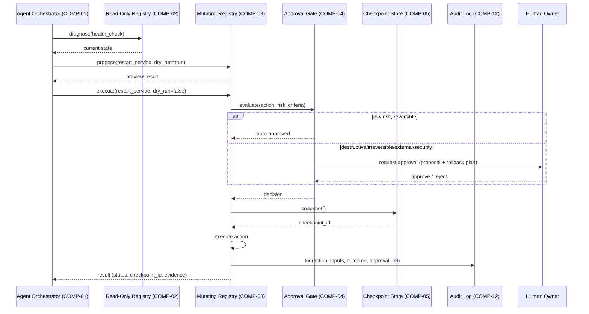
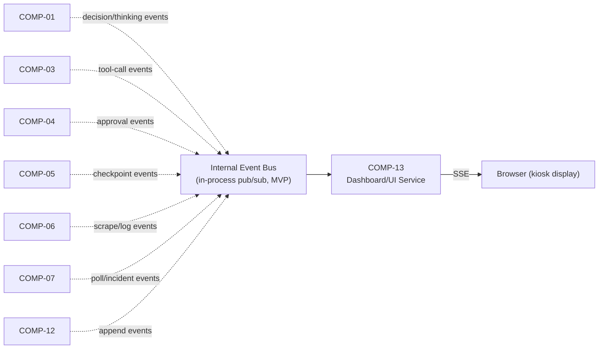
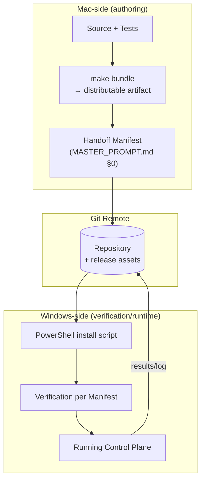
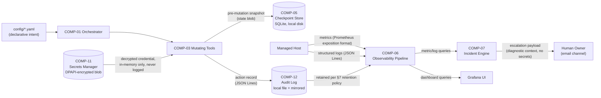
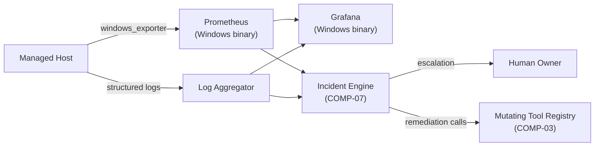

# SAS.md — OpsPilot Cloud Software Architecture Specification

**Status:** v0.1. Governed by [MASTER_PROMPT.md](./MASTER_PROMPT.md). Satisfies [PRD.md](./PRD.md).
**Related documents:** [IMPLEMENTATION.md](./IMPLEMENTATION.md) sequences the build of the components below · [ENGINEERING_REFERENCE.md](./ENGINEERING_REFERENCE.md) records schemas/ADRs referenced here.

---

## 1. Architectural Principles and Constraints

- **AP-1. Windows-native runtime, cross-platform authoring.** Every component that runs on a managed host executes on Windows 11 Pro/Windows Server with PowerShell 7+ and Python 3.11+ only (MASTER_PROMPT.md §1). Build/test tooling used during Mac-side authoring (MASTER_PROMPT.md §0) is not part of the runtime architecture and imposes no constraint here.
- **AP-2. Separation of control plane and managed host.** The AI agent orchestration layer (the "control plane") is architecturally distinct from the managed Windows host(s) it operates. For MVP, both may run on the same single host, but the interfaces between them are defined as if they were remote, so multi-host (Post-MVP, FR-003) requires no redesign — only configuration.
- **AP-3. Mutating and read-only tools are separate interfaces.** Enforced at the architecture level, not just convention (MASTER_PROMPT.md §3 principle 6): the agent's tool-execution layer exposes two disjoint tool registries.
- **AP-4. Every mutation is checkpointed and reversible.** No component performs a mutating operation without first writing a recoverable checkpoint (FR-070).
- **AP-5. Everything the agent does is observable from outside the agent.** State, decisions, and actions are externalized to structured logs/state store, not held only in agent conversational memory — required for resumability (MASTER_PROMPT.md §9) and for the Mac/Windows handoff model (MASTER_PROMPT.md §0).
- **AP-6. Config as data, not code.** All environment-specific values live in versioned config files with a validated schema (ENGINEERING_REFERENCE.md §4), never hardcoded.

---

## 2. System Context



**Trust boundaries** (detailed in §8): Owner↔CP is the human-approval boundary. GH is the only Mac↔Windows integration point — neither agent trusts the other's local state directly. CP↔Host is the privileged execution boundary (PowerShell running with scoped Windows credentials). CP↔Cloud/DNS crosses the network egress boundary and requires credentials scoped per MASTER_PROMPT.md §5.

---

## 3. Component Overview


COMP-13 is a **read-only consumer** of the other components' event streams (dashed lines above — subscribes, never calls into them) and introduces no new mutating tool; see §5.1 for why this keeps its risk/approval surface area at zero.

| ID | Component | Responsibility | Satisfies FRs |
|---|---|---|---|
| COMP-01 | Agent Orchestrator | Runs the AI agent's reasoning loop, dispatches tool calls, enforces checkpoint-before-mutate (AP-4) | FR-090–FR-093 |
| COMP-02 | Read-Only Tool Registry | Diagnostic/inspection tools only; no side effects | FR-090 |
| COMP-03 | Mutating Tool Registry | State-changing tools; every call routes through COMP-04 and COMP-05 first | FR-090, FR-091 |
| COMP-04 | Approval Gate Service | Evaluates each mutating call against approval-required criteria (MASTER_PROMPT.md §6); blocks until approved or auto-clears low-risk defaults | FR-092 |
| COMP-05 | Checkpoint/State Store | Snapshots config/state before mutation; supports restore | FR-070, FR-071 |
| COMP-06 | Observability Pipeline | windows_exporter → Prometheus → Grafana; structured log aggregation | FR-040–FR-044 |
| COMP-07 | Incident Engine | Health-check polling, failure detection, remediation playbooks, escalation | FR-050–FR-053 |
| COMP-08 | Deployment Engine | Packages/deploys Windows Service and Windows Container applications; rollout + rollback | FR-010–FR-014 |
| COMP-09 | Provisioning Engine | Terraform-driven host/infra provisioning | FR-001–FR-003 |
| COMP-10 | Reverse Proxy Manager | Caddy config generation, ACME cert lifecycle | FR-030–FR-032 |
| COMP-11 | Secrets Manager | DPAPI (MVP) / Vault (production) abstraction | NFR-009 |
| COMP-12 | Audit Log | Structured, append-only record of every agent action | FR-093, NFR-007 |
| COMP-13 | Dashboard/UI Service | Live "Mission Control" web dashboard (UI_SPEC.md); SSE event consumer, read-only, reverse-proxied through COMP-10 | FR-100–FR-108, NFR-013–015 |

---

## 4. Component Interfaces

All inter-component calls within the control plane are in-process Python function calls (MVP, single-host) behind an interface defined as if remote (AP-2), so a Post-MVP multi-host split only changes the transport, not the contract.

**Example interface contract — Mutating Tool Registry (COMP-03):**

```yaml
# ENGINEERING_REFERENCE.md §4 holds the full schema registry; this is illustrative.
tool: deploy_windows_service
kind: mutating
inputs:
  service_name: string
  package_path: string
  version: string
  dry_run: boolean          # FR-091 — every mutating tool must accept this
outputs:
  status: enum[success, failed, rolled_back, timed_out]
  checkpoint_id: string      # COMP-05 reference, always returned even on dry_run=false success
  evidence: object            # exit codes, health-check results — never fabricated (MASTER_PROMPT.md §7)
  attempt_count: integer       # how many of max_retries were actually used
preconditions:
  - approval_required: "evaluated by COMP-04 per MASTER_PROMPT.md §6 criteria"
  - checkpoint_taken: "COMP-05 snapshot exists before mutation begins (AP-4)"
  - least_privilege_account: "scoped service account per ENGINEERING_REFERENCE.md §5.2 — never LocalSystem unless documented exception"
execution_policy:
  timeout_seconds: 120        # hard ceiling; execution is force-terminated and treated as EXECUTION_FAILED past this
  max_retries: 2               # bounded per MASTER_PROMPT.md §3 principle 7 / brief §6 — never unbounded
  retry_backoff: "exponential, base 5s, capped at 60s between attempts"
  retryable_error_modes: [EXECUTION_FAILED]   # APPROVAL_DENIED/PRECONDITION_FAILED are never retried automatically
post_execution_verification:
  - "health_check or equivalent state assertion run after execution and before status=success is returned (never inferred from exit code alone)"
error_modes:
  - PRECONDITION_FAILED
  - APPROVAL_DENIED
  - APPROVAL_TIMEOUT
  - EXECUTION_FAILED   # triggers automatic rollback per FR-013
  - TIMEOUT_EXCEEDED   # treated as EXECUTION_FAILED for rollback purposes, logged distinctly for diagnosis
```

`execution_policy` and `post_execution_verification` are **required fields on every COMP-03 tool contract, not just this example** — this is how brief §6's "every infrastructure-changing operation must have... a timeout and bounded retry policy... post-operation verification" is enforced concretely rather than left as a general policy statement. Read-only tools (COMP-02) require `timeout_seconds` but not `max_retries`/rollback fields, since they have no state to roll back.

Every tool in COMP-02/COMP-03 is defined this way in ENGINEERING_REFERENCE.md §4 before implementation (MASTER_PROMPT.md §3 principle 1).

---

## 5. AI Agent Architecture and Tool Execution Model



**Key rules enforced architecturally, not just by policy:**
- The agent cannot call a mutating tool directly without passing through COMP-04 — this is a hard dependency in the code, not a convention the agent chooses to follow.
- `dry_run=true` is a distinct code path from `dry_run=false`, not a flag that's checked and ignored (FR-091).
- COMP-05's checkpoint call is synchronous and blocking before execution — if checkpointing fails, the mutation does not proceed (AP-4).
- The agent's reasoning/planning (what to do next) is separate from tool execution (COMP-01 vs COMP-02/03) so that logs capture ground truth regardless of what the agent "intended."

### 5.1 Dashboard/UI Service (COMP-13) — Event Subscription Model

COMP-13 is architecturally a **passive subscriber**, never a participant in the sequence in §5 above — it cannot call COMP-02/03, cannot affect COMP-04's decisions, and its own failure or restart cannot stall or break the agent loop (NFR-014). It subscribes to the same structured events every other component already produces for its own purposes (logging, audit, checkpointing) and re-emits them to connected browser clients over Server-Sent Events (UI_SPEC.md §7):



**Why an internal event bus rather than COMP-13 polling each component directly:** every upstream component already emits a structured event at the moment something happens (that's what makes its own logging/audit truthful per MASTER_PROMPT.md §7) — COMP-13 taps the same event, it does not re-derive or infer it. This guarantees FR-107/NFR-015 (no fabricated UI state) structurally: there is no code path in COMP-13 that produces a visual event without a corresponding upstream emission. For MVP (single-host, AP-1/AP-2), this bus is an in-process Python pub/sub (e.g., an `asyncio.Queue`-backed dispatcher); Post-MVP multi-host would promote it to a real message bus without changing COMP-13's consumer contract, consistent with AP-2's "interfaces shaped as if remote" principle.

**The one explicitly unresolved wiring (ADR-008, ENGINEERING_REFERENCE.md §2):** per-database query-start/query-complete events (driving UI_SPEC.md §4.4's per-cell blink) depend on instrumentation at the database driver/connection-pool layer, which is specific to whatever DB engine(s) a given deployment actually runs. This is deployment-dependent and cannot be finalized generically — IMPLEMENTATION.md's dashboard phase ships the event-bus/UI framework against all other sources first, with DB query-level events as a named adapter interface implemented per target engine.

---

## 6. Windows-Native Infrastructure Architecture

| Concern | Choice | Rationale / source |
|---|---|---|
| Containers | Windows Containers via `containerd` + Docker Engine on Windows Server; Docker Desktop Windows-container mode on Win 11 Pro/Enterprise (dev/edge) | No WSL dependency in this mode; confirmed via Docker's official Windows install docs. See ADR-003 below for the Linux-container-workload limitation. |
| IaC/Provisioning | Terraform (official Windows binary) run from PowerShell 7 wrappers; Bicep/ARM documented as an Azure-native alternative | No Linux required; mature multi-cloud provider ecosystem. |
| Reverse proxy / TLS | Caddy (Windows binary), built-in automatic HTTPS via ACME | No external cert-automation tooling needed; statically compiled, no runtime deps. |
| CI/CD | GitHub Actions `windows-latest` hosted runners (default), self-hosted Windows runners (for private network access) | Actively maintained, no Linux/WSL required. |
| Metrics | windows_exporter (native Windows service, MSI-installed) → Prometheus (Windows binary) | Modular collectors (cpu/memory/disk/net/iis/service/scheduled_task/mssql); confirmed native Windows support. |
| Dashboards | Grafana (native Windows server binary) | Cross-platform Go binary; no Linux dependency. |
| Agent runtime | Python 3.11+, `asyncio` with **ProactorEventLoop** (the Windows default — must not be overridden) | `SelectorEventLoop` does not support `subprocess_exec`/`subprocess_shell` on Windows at all (CPython docs) — this is a hard implementation constraint for any agent code that shells out to PowerShell. |
| Secrets | DPAPI (`ConvertTo-SecureString`, local) for MVP; HashiCorp Vault (official Windows server binary) for production multi-node | Phased per ADR-004. |
| Service supervision | Native Windows Services (`New-Service`, `sc.exe`) primary; NSSM as fallback wrapper for scripts/executables without native service support; Task Scheduler for cron-equivalent jobs | Sufficient native fit; no systemd-equivalent gap. |

### ADR-003 — Linux-container workloads are out of MVP scope (documented trade-off, not silent violation)

Most SMB/startup open-source applications ship Linux-only container images. A strict reading of "Windows containers only" means OpsPilot Cloud cannot deploy such images in MVP. This is a **real, material limitation**, stated honestly rather than worked around:
- **What we do NOT do:** silently run WSL2 or a Linux VM to "sneak" Linux containers in under a Windows-only banner.
- **What we do instead:** MVP supports Windows Containers and native Windows Services only (FR-011, FR-014 excluded from MVP). The Post-MVP option under evaluation is a Hyper-V-isolated Linux-container path on Windows Server, which is still a Windows Server host operating Windows-native virtualization (not a bolted-on Linux VM the operator manages) — but it is still functionally running Linux binaries, so it will be presented to users as an explicit, opt-in compatibility mode with its own risk disclosure, never as transparently "part of the Windows-only platform." This decision is revisited at the MVP retrospective (PRD.md §9 Phase 7).

### ADR-004 — Secrets: DPAPI now, Vault later
MVP ships with DPAPI-based local secret encryption (zero extra infrastructure, sufficient for single-host). Multi-node (Post-MVP, FR-003/NFR-011) requires a shared secrets backend; HashiCorp Vault's Windows server binary is the selected target, deferred until multi-host is in scope to avoid premature infrastructure.

---

## 7. Deployment Architecture



**Rollout strategy for an application deployment (FR-012):** blue/green at the Windows Service or Container level — the new version is started alongside the old, health-checked (NFR-003-equivalent window), traffic is cut over at the Reverse Proxy Manager (COMP-10) only after verification passes, and the old version is retained (not torn down) until a post-cutover stability window elapses, enabling fast rollback (FR-013) without a fresh deploy.

---

## 8. Data Flows, State Management, Persistence, Configuration, and Trust Boundaries

### 8.0 Data Flows

Distinct from the control-flow/sequence diagrams in §5 and §7, this is what data actually moves between components, in what form, and where it lands at rest.



**Data classification and handling rules:**
| Data | Format | At rest | In transit | Never |
|---|---|---|---|---|
| Config/declared intent | YAML, schema-validated | Git-tracked (non-secret values only) | Loaded in-process | Secrets interpolated directly into tracked config files |
| Secrets/credentials | DPAPI-encrypted blob (MVP) | Windows-local, tied to service account | Decrypted in-process memory only, scoped to the call that needs it | Written to logs, audit entries, checkpoints, or committed config |
| Checkpoints/state snapshots | Serialized state blob | SQLite, local disk | N/A (local store) | Transmitted off-host in MVP (single-host scope) |
| Metrics | Prometheus exposition format | Prometheus TSDB | Scrape pull over local network path | Used as the sole input to a destructive decision without corroborating evidence (MASTER_PROMPT.md §7) |
| Logs/audit entries | JSON Lines | Local file, rotated, mirrored to Observability Pipeline | File write + periodic mirror | PII beyond what PRD.md NFR table permits; secrets (redaction enforced at the logging call site) |
| Escalation payloads | Structured diagnostic context | N/A (transient) | Email channel (MVP, FR-052) | Contain raw secrets or unredacted credentials, even for diagnostic completeness |

This table is the concrete answer to "where does data go and in what form" that the trust-boundary list below answers in terms of "who may cross with it."

### 8.1 State Management, Persistence, Configuration

- **Configuration:** versioned YAML under `config/` (schema in ENGINEERING_REFERENCE.md §4), loaded at control-plane startup and on-demand reload for non-disruptive settings.
- **State store (COMP-05):** local embedded store (MVP: SQLite via Python, chosen for zero-install Windows compatibility) holding checkpoints, deployment history, and incident records. Multi-host (Post-MVP) migrates this to a shared store — the interface (AP-2) already anticipates this.
- **Audit log (COMP-12):** append-only, structured (JSON Lines), written to a Windows-local file with log rotation, mirrored to the Observability Pipeline (COMP-06) for retention/search.
### 8.2 Trust Boundaries

  1. **Owner ↔ Control Plane** — human approval is the only way past COMP-04 for gated actions; no other path exists in the codebase.
  2. **Git Remote as the Mac↔Windows boundary** — neither agent executes code or reads state from the other's live session; all exchange is through committed, reviewable files (MASTER_PROMPT.md §0). This makes the remote itself a trust boundary: anything pulled from it is treated as the authoritative next state, not merged with assumptions from a prior session.
  3. **Control Plane ↔ Managed Host** — PowerShell execution uses a scoped service account, least-privilege (MASTER_PROMPT.md §5), never the interactive admin session.
  4. **Control Plane ↔ External (Cloud APIs, DNS/ACID CA)** — network egress is allowlisted; credentials are scoped per-provider and never shared across integrations.

---

## 9. Monitoring and Observability Architecture



Alert evaluation (FR-042) runs inside the Incident Engine (COMP-07) against Prometheus-collected metrics and log-derived signals; this avoids a dependency on Alertmanager for MVP (fewer moving Windows services), revisited if alert-rule complexity grows (documented as an Assumption, ENGINEERING_REFERENCE.md §9).

---

## 10. Failure Handling, Rollback, and Recovery

| Failure class | Detection | Response | FR/NFR |
|---|---|---|---|
| Process crash | Health-check poll (COMP-07) | Restart via COMP-03, bounded retries, then escalate | FR-050–FR-052, NFR-003/004 |
| Bad deployment | Post-deploy health window fails | Automatic rollback to prior checkpoint (COMP-05) | FR-013, NFR-006 |
| TLS renewal failure | ACME renewal job fails | Alert ≥14 days before expiry; retry with backoff; never silently serve expired/invalid cert | FR-031, failure table in PRD.md §7 |
| Config drift | Periodic reconciliation compares live state to declared config | Alert (FR-061); remediation requires approval if the drift-correcting action is itself destructive | FR-061 |
| Checkpoint/restore failure | Checksum/integrity check on checkpoint read | Hard-stop the dependent mutation; escalate — never proceed on an unverifiable checkpoint | AP-4 |
| Mac↔Windows handoff interrupted | Resumed session reads Handoff Manifest status fields | Resume from last `Verified-Mac`/`Verified-Windows` boundary; no work is silently repeated or skipped | MASTER_PROMPT.md §0, §9 |

---

## 11. Architectural Decisions and Trade-offs (summary)

Full ADR log lives in ENGINEERING_REFERENCE.md §9. Key decisions made in this document:

- **ADR-001:** Single-host MVP, remote-shaped interfaces for Post-MVP multi-host (AP-2) — avoids premature distributed-systems complexity while not architecturally foreclosing it.
- **ADR-002:** In-process Python tool registries for MVP rather than a separate microservice per tool — simpler to build/verify within the MVP timeline; revisited if tool count/isolation needs grow.
- **ADR-003:** Linux-container workloads excluded from MVP (§6 above) — the most consequential and most honestly-stated scope trade-off in this document.
- **ADR-004:** DPAPI-then-Vault secrets phasing (§6 above).
- **ADR-005:** Alert evaluation inside the Incident Engine rather than a dedicated Alertmanager for MVP (§9 above).

---

## 12. Traceability: PRD Requirements → Architectural Components

| PRD requirement(s) | SAS component(s) | Notes |
|---|---|---|
| FR-001–003 | COMP-09 | Provisioning Engine |
| FR-010–014 | COMP-08, COMP-10 | Deployment + routing |
| FR-020–021 | (external) GitHub Actions → COMP-08 trigger | CI/CD is an external trigger into Deployment Engine |
| FR-030–032 | COMP-10 | Reverse Proxy Manager |
| FR-040–044 | COMP-06 | Observability Pipeline |
| FR-050–053 | COMP-07 | Incident Engine |
| FR-060–062 | COMP-09, COMP-07 (drift) | Hardening at provisioning time, drift detection via Incident Engine |
| FR-070–072 | COMP-05 | Checkpoint/State Store |
| FR-080, FR-082 | COMP-06, COMP-07 | Reporting draws from observability + incident history; FR-082 utilization recording extends COMP-06's existing metrics pipeline |
| FR-090–093 | COMP-01, COMP-02, COMP-03, COMP-04, COMP-12 | The full agent safety/tooling stack |
| FR-100–108 | COMP-13 (consumes COMP-01, 03, 04, 05, 06, 07, 12 via the event bus, §5.1) | Mission Control Dashboard, UI_SPEC.md |
| NFR-001 (Windows-only) | All components | AP-1; enforced per-component in ENGINEERING_REFERENCE.md §2 |
| NFR-007/008 (audit/approval integrity) | COMP-04, COMP-12 | |
| NFR-009 (secrets) | COMP-11 | |
| NFR-013–015 (dashboard latency/independence/no-fabrication) | COMP-13 | §5.1 event-bus design is the structural enforcement mechanism for NFR-015 specifically |

Every row here must have a corresponding IMPLEMENTATION.md task before work begins (MASTER_PROMPT.md §9; PRD.md §8 acceptance test mapping).
